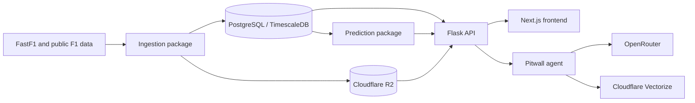

# Project overview

Slipstream turns Formula 1 session data into browser-based analysis. Users can
inspect race and qualifying sessions, compare selected telemetry, review tyre
and pit strategy, and explore pre-race predictions. The Pitwall agent provides
a conversational interface to selected analyses and approved reference
documents.

## Services

- **Frontend:** session browser, telemetry visualizations, race/practice
  analysis, schedule, predictions, and agent chat.
- **Backend:** Flask API for session data and computed analysis. SQL reads use
  parameterized queries.
- **Ingestion:** FastF1 and public-data adapters normalize sessions into the
  shared database. Telemetry artifacts and approved source documents can be
  stored in R2.
- **Predictions:** ML features use qualifying, historical race results, and
  optional practice or sprint information.
- **Agent:** coordinates bounded backend tools and an optional LLM. Approved
  text sources can be searched with Vectorize; race facts come from the
  database and artifacts.

## Data principles

- PostgreSQL is the source of truth for sessions, laps, drivers, weather,
  positions, and coverage metadata.
- Raw telemetry and source files are stored as artifacts; they are not treated
  as conversational memory.
- Vector search is for approved document text, not numeric telemetry or
  session availability.
- The agent must state when data is missing and must not invent measurements or
  citations.

## External services

Local development uses Docker Compose for the database and supporting
services. Production configuration can include Clerk authentication, Fly.io,
Cloudflare R2/Vectorize, and OpenRouter. Core session browsing and analytics
do not require OpenRouter; agent language-model features do.
